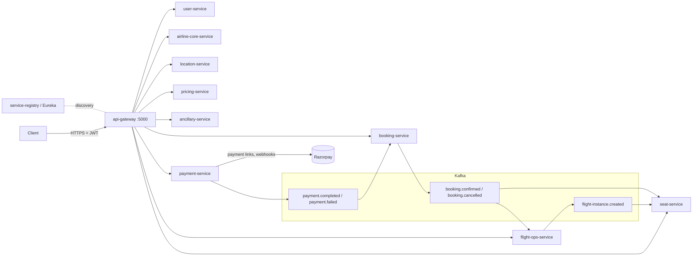
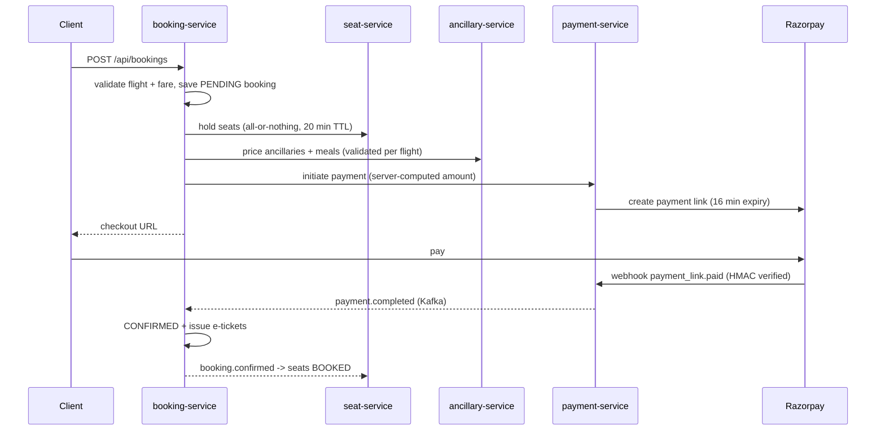

# Airline Platform

Microservices backend for an airline: flight scheduling and search, seat inventory, fares and ancillaries,
bookings (PNRs) and payments. Java 21, Spring Boot 4, Spring Cloud 2025, MySQL 8.4, Kafka 4.

> A review of the codebase, the issues fixed during production hardening and the remaining gaps is in
> [docs/PRODUCTION_REVIEW.md](docs/PRODUCTION_REVIEW.md).

## Architecture



| Service | Port | Database | Owns |
|---|---|---|---|
| `api-gateway` | 5000 | - | Routing, JWT validation, edge authorization ([AccessPolicy](cloud/api-gateway/src/main/java/com/baldev/airline/gateway/security/AccessPolicy.java)), CORS |
| `service-registry` | 8761 | - | Eureka service discovery |
| `user-service` | 5001 | `airline_user_db` | Users, signup/login, JWT issuance |
| `airline-core-service` | 5002 | `airline_core_db` | Airlines (admin-approved), aircraft |
| `location-service` | 5004 | `airline_location_db` | Cities, airports |
| `pricing-service` | 5005 | `airline_pricing_db` | Fares, fare rules, baggage policies |
| `seat-service` | 5006 | `airline_seat_db` | Cabins, seat maps, per-flight seat inventory and holds |
| `ancillary-service` | 5008 | `airline_ancillary_db` | Meals, ancillaries, insurance |
| `booking-service` | 5009 | `airline_booking_db` | Bookings (PNR snapshot), passengers, e-tickets |
| `payment-service` | 5010 | `airline_payment_db` | Payments, Razorpay integration |
| `flight-ops-service` | 5011 | `airline_flight_db` | Flights, schedules, dated flight instances, search |

Each service owns its database; no service reads another's tables.

### Booking flow



Any failure after the hold compensates: seats are released and the booking is cancelled. Abandoned holds expire
automatically. Every Kafka consumer is idempotent, because delivery is at least once.

## Repository layout

```
pom.xml                    parent: versions, plugins, Jib, enforcer, JaCoCo
common-lib/                shared contracts + auto-configured cross-cutting concerns
  .../common/exception     typed exceptions -> RFC 9457 problem details
  .../common/web           GlobalExceptionHandler, CurrentUser, identity headers
  .../common/feign         error decoder (downstream 404/409/422 keep their meaning)
  .../common/kafka         topics, retry + dead-letter handling
  .../common/payload|event DTOs and event contracts
cloud/                     api-gateway, service-registry
services/<name>/           one Spring Boot app per bounded context
  src/main/java/com/baldev/airline/<name>/
    controller/            public REST API (/api/**)
    controller/internal/   service-to-service API (/internal/**, never routed by the gateway)
    service/ (+impl/)      business logic and transactions
    repository/ model/ mapper/ client/ messaging/ config/
  src/main/resources/
    application.yaml       production-safe base config (env driven)
    application-local.yaml local development overrides
    db/migration/          Flyway migrations
docker-compose/            full local stack
```

## Running locally

Prerequisites: JDK 21, Docker.

```bash
# 1. Infrastructure: databases, Kafka, registry
cp docker-compose/.env.example docker-compose/.env    # fill in the secrets
docker compose -f docker-compose/docker-compose.yml --env-file docker-compose/.env \
  up -d userdb airlinecoredb flightopsdb locationdb pricingdb ancillarydb bookingdb paymentdb seatdb kafka kafka-ui

# 2. Build
./mvnw -B verify

# 3. Run the registry, the gateway and the services you need, each with the local profile, e.g.
java -jar cloud/service-registry/target/service-registry-*.jar
SPRING_PROFILES_ACTIVE=local java -jar cloud/api-gateway/target/api-gateway-*.jar
SPRING_PROFILES_ACTIVE=local DB_PASSWORD=<DB_PASSWORD from .env> java -jar services/user-service/target/user-service-*.jar
```

Or run the whole stack in containers:

```bash
./mvnw -B -DskipTests package jib:dockerBuild
docker compose -f docker-compose/docker-compose.yml --env-file docker-compose/.env up -d
```

The local profile ships development-only defaults (JWT key, bootstrap admin `admin@airline.local`). Production
must not use it.

## Configuration

All environment-specific settings are environment variables. Secrets have no defaults, so the service fails
at startup if one is missing.

| Variable | Used by | Notes |
|---|---|---|
| `DB_URL`, `DB_USERNAME`, `DB_PASSWORD` | all business services | JDBC URL of the service's own database |
| `EUREKA_URL` | all | default `http://localhost:8761/eureka/` |
| `KAFKA_BOOTSTRAP_SERVERS` | flight-ops, seat, booking, payment | |
| `JWT_SECRET` | gateway, user-service | at least 32 bytes, identical in both |
| `JWT_ISSUER`, `JWT_EXPIRATION` | gateway, user-service | default issuer `airline-user-service`, expiry `PT1H` |
| `BOOTSTRAP_ADMIN_EMAIL`, `BOOTSTRAP_ADMIN_PASSWORD` | user-service | optional, creates the first admin once |
| `RAZORPAY_KEY_ID`, `RAZORPAY_KEY_SECRET`, `RAZORPAY_WEBHOOK_SECRET` | payment-service | |
| `PAYMENT_CALLBACK_BASE_URL` | payment-service | frontend URL Razorpay redirects to after checkout |
| `CORS_ALLOWED_ORIGINS` | gateway | comma-separated, no wildcard |
| `LOGGING_STRUCTURED_FORMAT_CONSOLE` | all | `ecs` for JSON logs |
| `TRACING_SAMPLING_PROBABILITY`, `TRACING_EXPORT_ENABLED`, `OTEL_EXPORTER_OTLP_TRACES_ENDPOINT` | all | OpenTelemetry tracing |

Seat hold length (`airline.seat.hold-duration`, default 20 min) must stay longer than the payment link expiry
(`airline.payment.link-expiry`, default 16 min).

## API conventions

- **Auth:** `POST /auth/login` returns a JWT; send it as `Authorization: Bearer <token>`. The gateway validates it,
  removes any client-supplied `X-User-*` headers, and forwards the verified identity. Which roles can call which
  endpoints is defined in one table: [`AccessPolicy`](cloud/api-gateway/src/main/java/com/baldev/airline/gateway/security/AccessPolicy.java).
  Anything not listed there is denied.
- **Ownership** (your booking, your airline's flight) is enforced inside each service.
- **Errors** are [RFC 9457](https://www.rfc-editor.org/rfc/rfc9457) problem details with a stable `code`:
  ```json
  { "status": 409, "detail": "Seat 12A is no longer available", "code": "SEAT_UNAVAILABLE" }
  ```
- **Money** is a decimal with 2 places (never a float); the currency is explicit.
- **Internal endpoints** live under `/internal/**` and are unreachable through the gateway.

## Database migrations

Schemas are owned by Flyway (`src/main/resources/db/migration`); Hibernate only validates them
(`ddl-auto: validate`). To change a schema, add a new `V<n>__description.sql`. Never edit a migration that
has been applied anywhere.

## Observability

- `GET /actuator/health/liveness` and `/actuator/health/readiness`: probes for orchestrators. On the gateway,
  actuator runs on the private management port `5100` (`MANAGEMENT_PORT`), never on the public port 5000.
- `GET /actuator/prometheus`: metrics (HTTP, JVM, Hikari, Kafka)
- Traces: W3C `traceparent` propagated across HTTP and Kafka; export with `TRACING_EXPORT_ENABLED=true`
- Logs: include trace ids; JSON with `LOGGING_STRUCTURED_FORMAT_CONSOLE=ecs`
- Failed Kafka records land on `<topic>-dlt` after retries; alert on DLT lag
- Kafka UI (local only): http://localhost:8090 shows topics, messages with headers, consumer groups and lag

## Testing and CI

**End-to-end with Postman:** [postman/README.md](postman/README.md) has a collection that runs every flow
(sign-up, onboarding, flights, search, checkout, webhook and browser payment, failures, back office) against a
locally running stack. It needs no Razorpay account: `scripts/start-local.ps1` starts payment-service with
the offline `payment-stub` profile.


```bash
./mvnw -B verify        # unit tests + JaCoCo coverage report (target/site/jacoco)
```

GitHub Actions ([ci.yml](.github/workflows/ci.yml)) builds and tests every PR. On `main` it also publishes images to
GHCR with Jib.
