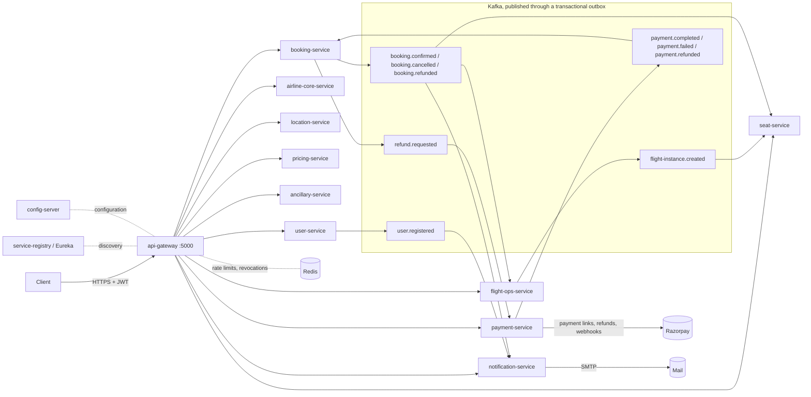
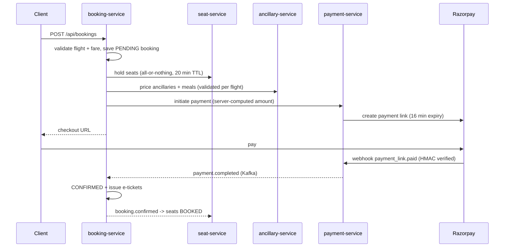

# Airline Platform

Microservices backend for an airline: flight scheduling and search, seat inventory, fares and ancillaries,
bookings (PNRs), payments and refunds, and customer notifications. Java 21, Spring Boot 4, Spring Cloud 2025
(Config, Eureka, Gateway, OpenFeign, Resilience4j), MySQL 8.4, Kafka 4, Redis 8.

> A review of the codebase, the issues fixed during production hardening and the remaining gaps is in
> [docs/PRODUCTION_REVIEW.md](docs/PRODUCTION_REVIEW.md).

## Architecture



| Service | Port | Database | Owns |
|---|---|---|---|
| `api-gateway` | 5000 | - | Routing, token verification and edge authorization with Spring Security ([GatewayAccessRules](cloud/api-gateway/src/main/java/com/baldev/airline/gateway/security/GatewayAccessRules.java)), rate limits, CORS |
| `service-registry` | 8761 | - | Eureka service discovery |
| `config-server` | 8888 | - | Spring Cloud Config: serves `config-repo/` to every service (HTTP basic auth) |
| `user-service` | 5001 | `airline_user_db` | Users, signup/login, RS256 access tokens + JWKS, refresh tokens |
| `airline-core-service` | 5002 | `airline_core_db` | Airlines (admin-approved), aircraft |
| `location-service` | 5004 | `airline_location_db` | Cities, airports |
| `pricing-service` | 5005 | `airline_pricing_db` | Fares, fare rules, baggage policies |
| `seat-service` | 5006 | `airline_seat_db` | Cabins, seat maps, per-flight seat inventory and holds |
| `ancillary-service` | 5008 | `airline_ancillary_db` | Meals, ancillaries, insurance |
| `booking-service` | 5009 | `airline_booking_db` | Bookings (PNR snapshot), passengers, e-tickets |
| `payment-service` | 5010 | `airline_payment_db` | Payments, refunds, Razorpay integration |
| `flight-ops-service` | 5011 | `airline_flight_db` | Flights, schedules, dated flight instances, search |
| `notification-service` | 5012 | `airline_notification_db` | Customer e-mails and in-app inbox, from Kafka events |

Each service owns its database; no service reads another's tables. Redis is shared infrastructure, namespaced per
service (`airline:<service>:...`).

### Booking flow



Any failure after the hold compensates: seats are released and the booking is cancelled. Abandoned holds expire
automatically. Every event is written to a transactional outbox in the same transaction as the state change and
relayed to Kafka after commit, so none is lost; every consumer is idempotent, because delivery is at least once.

Cancelling a ticketed booking applies the fare's rules (non-refundable, refund deadline, cancellation fee per
passenger), voids the tickets, releases the seats and asks payment-service for the refund (`refund.requested`).
The refund is idempotent per refund key, completed by Razorpay's webhook or the reconciliation job, and ends with
`booking.refunded`, which notification-service turns into an e-mail. A payment that arrives after its booking was
cancelled is refunded the same way.

## Repository layout

```
pom.xml                    parent: versions, plugins, Jib, enforcer, JaCoCo
config-repo/               central configuration served by config-server (no secrets: env placeholders only)
common-lib/                event contracts + auto-configured cross-cutting concerns
  .../common/exception     typed exceptions -> RFC 9457 problem details
  .../common/web           GlobalExceptionHandler, CurrentUser (from the verified token)
  .../common/security      Spring Security resource server for gateway and services (JWKS decoder, validators,
                           revocation, problem-details 401/403/503)
  .../common/feign         error decoder (downstream 404/409/422 keep their meaning), token relay
  .../common/kafka         topics, retry + dead-letter handling
  .../common/outbox        transactional outbox (publisher + relay)
  .../common/cache         Redis cache (typed CacheSpec, fails open)
  .../common/event         event contracts (the only DTOs shared between services)
cloud/                     api-gateway, service-registry, config-server
services/<name>/           one Spring Boot app per bounded context
  src/main/java/com/baldev/airline/<name>/
    controller/            public REST API (/api/**)
    controller/internal/   service-to-service API (/internal/**, never routed by the gateway)
    payload/               this service's API models (requests, responses)
    client/ + client/dto/  Feign clients and this service's copies of the models it consumes
    service/ (+impl/)      business logic and transactions
    repository/ model/ mapper/ messaging/ config/
  src/main/resources/
    application.yaml       bootstrap only: name, port, config-server import
    application-local.yaml local config-server credentials
    db/migration/          Flyway migrations
docker-compose/            full local stack
frontend/                  Angular customer website (see frontend/README.md)
```

## Web app

`frontend/` is the customer website (Angular 22): flight search, fares, seat map, meals and bags, payment
and "My trips". With the backend running:

```bash
cd frontend && npm install && npm start    # http://localhost:5173, proxies /api and /auth to :5000
```

Port 5173 matches the local `CORS_ALLOWED_ORIGINS` and `PAYMENT_CALLBACK_BASE_URL` defaults, so payment
redirects come back to the app. Details in [frontend/README.md](frontend/README.md).

## Running locally

Prerequisites: JDK 21, Docker.

```bash
# 1. Infrastructure: databases, Kafka, Redis, Mailpit
cp docker-compose/.env.example docker-compose/.env    # fill in the secrets (REDIS_PASSWORD at least)
docker compose -f docker-compose/docker-compose.yml --env-file docker-compose/.env \
  up -d userdb airlinecoredb flightopsdb locationdb pricingdb ancillarydb bookingdb paymentdb seatdb notificationdb \
        kafka kafka-ui redis mailpit prometheus grafana

# 2. Build
./mvnw -B verify

# 3. Start everything (config-server first, then the registry, services and gateway) with the local profile
./scripts/start-local.ps1          # stop with ./scripts/stop-local.ps1
```

Or start single services by hand; config-server must run first and every service needs `REDIS_PASSWORD`:

```bash
CONFIG_REPO_LOCATION=file:./config-repo/ SPRING_PROFILES_ACTIVE=local java -jar cloud/config-server/target/config-server-*.jar
java -jar cloud/service-registry/target/service-registry-*.jar
SPRING_PROFILES_ACTIVE=local REDIS_PASSWORD=<from .env> java -jar services/user-service/target/user-service-*.jar
```

Locally, user-service generates a temporary token signing key at startup (restarting it signs everyone out) and
every e-mail lands in Mailpit at http://localhost:8025.

Or run the whole stack in containers:

```bash
./mvnw -B -DskipTests package jib:dockerBuild
docker compose -f docker-compose/docker-compose.yml --env-file docker-compose/.env up -d
```

To run it on a public server (HTTPS, nothing but ports 80/443 exposed), see
[docs/DEPLOYMENT.md](docs/DEPLOYMENT.md); the overall plan is in [docs/DEPLOYMENT_PLAN.md](docs/DEPLOYMENT_PLAN.md).

The local profile ships development-only defaults (ephemeral signing key, config-server password, bootstrap admin
`admin@airline.local`). Production must not use it.

## Configuration

Configuration lives in `config-repo/` and is served by config-server: `application.yaml` for every service,
`<service>.yaml` for one service, `*-<profile>.yaml` per environment (later files win). It contains no secrets,
only `${ENV_VAR}` placeholders that each service resolves from its own environment; a test fails the build if a
plaintext secret is committed there. Production can serve the same layout from a Git repository
(`SPRING_PROFILES_ACTIVE=git`, `CONFIG_GIT_URI`), so configuration is reviewed and rolled back independently of
code. After a change, restart the service or `POST /actuator/refresh` (internal port only).

Secrets and environment-specific values are environment variables with no defaults, so a service fails at startup
if one is missing.

| Variable | Used by | Notes |
|---|---|---|
| `DB_URL`, `DB_USERNAME`, `DB_PASSWORD` | all business services | JDBC URL of the service's own database |
| `CONFIG_SERVER_URL`, `CONFIG_SERVER_PASSWORD` | all clients, config-server | default URL `http://localhost:8888`, user `config` |
| `CONFIG_REPO_LOCATION` | config-server | native backend directory; or `SPRING_PROFILES_ACTIVE=git` + `CONFIG_GIT_URI` |
| `EUREKA_URL` | all | default `http://localhost:8761/eureka/` |
| `KAFKA_BOOTSTRAP_SERVERS` | Kafka services | |
| `REDIS_HOST`, `REDIS_PORT`, `REDIS_PASSWORD`, `REDIS_SSL_ENABLED` | gateway, services | cache, rate limits, token revocation |
| `JWT_PRIVATE_KEY`, `JWT_KEY_ID` | user-service | RS256 PKCS#8 PEM (one line with `\n`); see *Tokens* below |
| `JWT_ISSUER`, `JWT_AUDIENCE`, `JWT_ACCESS_TOKEN_TTL`, `JWT_REFRESH_TOKEN_TTL` | all | defaults `airline-user-service`, `airline-api`, `15m`, `14d` |
| `SMTP_HOST`, `SMTP_PORT`, `SMTP_USERNAME`, `SMTP_PASSWORD`, `NOTIFICATION_FROM`, `PUBLIC_BASE_URL` | notification-service | |
| `RATE_LIMIT_ENABLED`, `RATE_LIMIT_TRUSTED_PROXIES` | gateway | policies in `config-repo/api-gateway.yaml` |
| `CACHE_ENABLED` | services | `false` turns the Redis cache off |
| `FLYWAY_BASELINE_ON_MIGRATE` | services | one-off for databases created by the old `ddl-auto`, see docs/PRODUCTION_REVIEW.md |
| `BOOTSTRAP_ADMIN_EMAIL`, `BOOTSTRAP_ADMIN_PASSWORD` | user-service | optional, creates the first admin once |
| `RAZORPAY_KEY_ID`, `RAZORPAY_KEY_SECRET`, `RAZORPAY_WEBHOOK_SECRET` | payment-service | |
| `PAYMENT_CALLBACK_BASE_URL` | payment-service | frontend URL Razorpay redirects to after checkout |
| `CORS_ALLOWED_ORIGINS` | gateway | comma-separated, no wildcard |
| `LOGGING_STRUCTURED_FORMAT_CONSOLE` | all | `ecs` for JSON logs |
| `TRACING_SAMPLING_PROBABILITY`, `TRACING_EXPORT_ENABLED`, `OTEL_EXPORTER_OTLP_TRACES_ENDPOINT` | all | OpenTelemetry tracing |

Seat hold length (`airline.seat.hold-duration`, default 20 min) must stay longer than the payment link expiry
(`airline.payment.link-expiry`, default 16 min).

## Tokens

- `POST /auth/login` (and signup) returns a 15-minute RS256 access token (`jwt`) and a single-use refresh token.
  `POST /auth/refresh` exchanges the refresh token for a new pair; presenting a refresh token twice means it was
  copied, so its whole session family and every access token of the user are revoked.
- `POST /auth/logout` revokes the session; `POST /api/users/me/logout-all` revokes all of them. Revocations live
  in Redis until the affected tokens expire.
- user-service publishes its public keys at `/.well-known/jwks.json` (internal, not routed). The gateway and every
  service fetch them through Eureka and verify signature, issuer, audience, expiry and revocation themselves.
- **Key rotation:** generate a new key (`openssl genpkey -algorithm RSA -pkeyopt rsa_keygen_bits:2048`), set it as
  `JWT_PRIVATE_KEY` with a new `JWT_KEY_ID`, list the old public key under `airline.security.signing.previous-keys`
  in `config-repo/user-service.yaml`, deploy user-service, and remove the old key after 15 minutes.

## API conventions

- **Auth:** send the access token as `Authorization: Bearer <token>`. Every component is a Spring Security
  OAuth2 resource server: the gateway verifies the token (RS256 against user-service's JWKS, issuer, audience,
  expiry, revocation) and applies the access rules; each service verifies it again and builds `CurrentUser` from
  it (Feign relays the token on service-to-service calls). Client-supplied `X-User-*` headers are removed and
  never trusted. Which roles can call which endpoints is defined in one table:
  [`GatewayAccessRules`](cloud/api-gateway/src/main/java/com/baldev/airline/gateway/security/GatewayAccessRules.java). Paths outside `/auth` and `/api` that it does
  not list are hidden (404). See [SECURITY_MIGRATION_PLAN.md](SECURITY_MIGRATION_PLAN.md) for how it works.
- **Ownership** (your booking, your airline's flight) is enforced inside each service.
- **Errors** are [RFC 9457](https://www.rfc-editor.org/rfc/rfc9457) problem details with a stable `code`:
  ```json
  { "status": 409, "detail": "Seat 12A is no longer available", "code": "SEAT_UNAVAILABLE" }
  ```
- **Money** is a decimal with 2 places (never a float); the currency is explicit.
- **Internal endpoints** live under `/internal/**` and are unreachable through the gateway.
- **Rate limits** per client IP at the gateway (login, signup, token refresh, search, everything else): over the
  limit the answer is `429` with `Retry-After`.
- **Caching:** reference data (airlines, aircraft, airports, cities, fares, flights) is cached in Redis with a TTL
  and evicted after every committed write. Redis being down only makes reads slower.
- **Degraded responses:** if airline or airport details cannot be loaded, flights are still returned with
  `partial: true` (circuit breakers in flight-ops-service).
- **Notifications:** e-mails and `GET /api/notifications` (the customer's inbox) come from Kafka events;
  notification-service retries e-mail delivery and never blocks the rest of the platform.

## Database migrations

Schemas are owned by Flyway (`src/main/resources/db/migration`); Hibernate only validates them
(`ddl-auto: validate`). To change a schema, add a new `V<n>__description.sql`. Never edit a migration that
has been applied anywhere.

## Observability

- `GET /actuator/health/liveness` and `/actuator/health/readiness`: probes for orchestrators. On the gateway,
  actuator runs on the private management port `5100` (`MANAGEMENT_PORT`), never on the public port 5000.
- `GET /actuator/prometheus`: metrics (HTTP, JVM, Hikari, Kafka)
- Traces: W3C `traceparent` propagated across HTTP and Kafka; export with `TRACING_EXPORT_ENABLED=true`
- Logs: include trace ids; JSON with `LOGGING_STRUCTURED_FORMAT_CONSOLE=ecs`
- Failed Kafka records land on `<topic>-dlt` after retries; alert on DLT lag
- Outbox: `outbox_events{state="pending"}` should stay near zero; `state="failed"` above zero needs a human
- Cache: `cache_gets_total{result}` (hit ratio) and `cache_errors_total`; rate limits:
  `gateway_ratelimit_rejected_total{policy}`; circuit breakers: `resilience4j_circuitbreaker_state`
- E-mail: `notifications_sent_total`, `notifications_failed_total`; local inbox http://localhost:8025 (Mailpit)
- Kafka UI (local only): http://localhost:8090 shows topics, messages with headers, consumer groups and lag
- Prometheus (local only): http://localhost:9090 scrapes every service; check Status > Target health. Set
  `PROMETHEUS_TARGETS=compose` in `.env` when the services run as containers instead of via `start-local.ps1`
- Grafana (local only): http://localhost:3000, user `admin`, password `GRAFANA_ADMIN_PASSWORD` from `.env`. The
  provisioned "Airline services" dashboard shows HTTP traffic, errors, latency, Hikari pool, Kafka lag and JVM

## Testing and CI

**End-to-end with Postman:** [postman/README.md](postman/README.md) has a collection that runs every flow
(sign-up, onboarding, flights, search, checkout, webhook and browser payment, failures, back office) against a
locally running stack. It needs no Razorpay account: `scripts/start-local.ps1` starts payment-service with
the offline `payment-stub` profile.


```bash
./mvnw -B verify        # unit + integration tests, JaCoCo coverage report (target/site/jacoco)
```

Integration tests use Testcontainers (MySQL, Kafka, Redis) and are skipped when Docker is not available: the
booking, payment and seat halves of the checkout and refund saga, notifications from Kafka to e-mail, the Redis
cache and the gateway rate limiter. They load the real `config-repo/` files.

GitHub Actions ([ci.yml](.github/workflows/ci.yml)) scans every push and PR for secrets (gitleaks), builds and
tests it. On `main` it also publishes images to GHCR with Jib.
