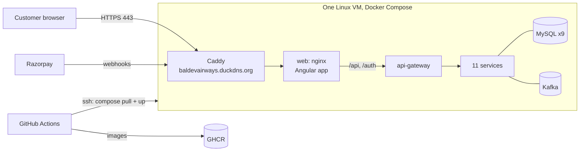

# Deployment plan

How the platform gets from this repository onto a public server, what has to change first, and how
Razorpay test mode works there without ever editing URLs by hand. The hosting provider is not chosen yet; the
plan is the same for any Linux VM.

> **Progress:** phases 1 and 2 are done. Local tunnels (ngrok, Cloudflare) are blocked or discouraged on the
> current work laptop, so webhooks are tested on the deployed server instead; locally the browser-return path
> confirms payments without them. How to run the production stack: [DEPLOYMENT.md](DEPLOYMENT.md).

| Decision | Status |
|---|---|
| Hosting provider | **Open.** Any Linux VM with ≥16 GB RAM (8 GB if monitoring is left out) |
| Domain | **None.** Free permanent hostnames instead (DuckDNS for the server, ngrok for local) |
| Payments on the demo | Razorpay **test mode** (real checkout page, test cards, no real money) |
| Deployment style | Docker Compose on one VM, deployed by GitHub Actions |

## 1. Readiness check

### Already in place

| Area | What exists |
|---|---|
| Container images | CI publishes all 12 images (11 services and the web app) to GHCR on every push to `main`; they are public |
| Orchestration | `docker-compose.yml` with health checks, restart policies, memory limits, and separate `backend`/`edge` networks |
| Exposure | Databases, Kafka, Eureka, Kafka UI, Prometheus and Grafana are bound to `127.0.0.1` only |
| Configuration | Everything comes from environment variables; required secrets (`JWT_SECRET`, `DB_PASSWORD`, `RAZORPAY_*`…) stop the stack at startup if missing |
| Databases | Flyway creates and migrates every schema on startup; no manual SQL |
| First admin | `BOOTSTRAP_ADMIN_EMAIL` / `BOOTSTRAP_ADMIN_PASSWORD` create it once |
| Web app | nginx serves it and proxies `/api` and `/auth` (same origin, no CORS), with CSP and security headers |
| Payments | Razorpay test mode verified end to end (checkout, verify, webhooks, expiry); live keys are refused locally |

### Gaps to close before going public

✅ = fixed.

| # | Gap | Why it matters | Fix |
|---|---|---|---|
| G1 ✅ | Compose defaults to image registry `baldevsinh` and tag `0.0.1-SNAPSHOT`, but CI publishes `ghcr.io/baldev-sinh/...` tagged only with the commit SHA | A server can't pull the right images by default | CI also tags `main`; production settings use `IMAGE_REGISTRY=ghcr.io/baldev-sinh` and a pinned `IMAGE_TAG` |
| G2 | Images are built for x86 (amd64) only | ARM servers (e.g. Oracle's free tier) can't run them | Build multi-arch images (Jib `platforms`, Docker Buildx) **only if** an ARM host is chosen |
| G3 ✅ | The gateway (`5000`) and web app (`5173`) are published on all interfaces | On a server the gateway must not be reachable directly, bypassing nginx | `docker-compose.prod.yml` override: nothing published except the HTTPS entry point |
| G4 ✅ | No HTTPS | Browsers, Razorpay and secure cookies need HTTPS | Add a **Caddy** container: automatic, free Let's Encrypt certificates for the DuckDNS hostname |
| G5 ✅ | Docker keeps container logs forever by default | A busy server fills its disk | Log rotation in the compose file (e.g. 3 × 10 MB per container) |
| G6 | A fresh server starts with empty databases | Visitors find no flights to book | A repeatable **demo seed**: real airports (BOM, DEL, BLR…), an airline, aircraft and seat maps, flight schedules for the coming months, fares, meals and bags |
| G7 ✅ | The public address is set in several places (`PAYMENT_CALLBACK_BASE_URL`, `CORS_ALLOWED_ORIGINS`) | Easy to update one and forget another | One variable, `PUBLIC_BASE_URL`, that the others derive from |
| G8 | No deployment automation | Manual SSH steps are slow and error-prone | GitHub Actions `deploy` job (section 4) |
| G9 | No database backups | A broken disk loses all bookings | Nightly `mysqldump` of each database, kept for 7 days (optional for a demo) |
| G10 | Nine separate MySQL servers use ~3 GB RAM | Pushes the minimum server size to 16 GB | Optional later: one MySQL server with nine schemas and nine users (still one database per service) |

## 2. Target setup



Only ports **22** (SSH, ideally restricted to your IP), **80** (Let's Encrypt and the redirect to HTTPS) and **443**
are open. Grafana, Kafka UI and Eureka stay on `127.0.0.1` and are reached through an SSH tunnel when needed.

## 3. Stable URLs without a domain

The Razorpay webhook URL kept changing only because Cloudflare's *quick* tunnel picks a random address every
time. Both environments get a permanent, free hostname instead:

| Environment | Public address | Cost | Provided by |
|---|---|---|---|
| Local development | `https://<your-name>.ngrok-free.app` | Free | ngrok's free plan includes one permanent dev domain per account; its 1 GB / 20,000 requests a month is plenty, because only Razorpay's webhooks use it |
| Demo server | `https://baldevairways.duckdns.org` | Free | DuckDNS (free subdomains pointing at the server's IP); Caddy gets the HTTPS certificate automatically |

**Configuration per environment is one variable:**

```
PUBLIC_BASE_URL=https://baldevairways.duckdns.org   # server
PUBLIC_BASE_URL=http://localhost:5173               # local (the browser returns to localhost)
```

`PAYMENT_CALLBACK_BASE_URL` and `CORS_ALLOWED_ORIGINS` are derived from it.

**Razorpay setup is once per environment, never repeated:**

| Razorpay webhook (test mode) | URL |
|---|---|
| `local-dev` | `https://<your-name>.ngrok-free.app/api/payments/webhooks/razorpay` |
| `demo-server` | `https://baldevairways.duckdns.org/api/payments/webhooks/razorpay` |

Both can use the same test keys. Each environment's `.env` holds the matching webhook secret.

**Local workflow after this change:** `scripts/start-local.ps1 -RealPayments -Tunnel` starts the services and the
ngrok tunnel on your permanent address, reading `NGROK_AUTHTOKEN` and `NGROK_DOMAIN` from `docker-compose/.env`.
No URL to copy, nothing to update in Razorpay.

If you buy a domain later, only `PUBLIC_BASE_URL`, the DNS record and the Razorpay webhook URL change.

## 4. How a release reaches the server

**One-time server setup (about 30 minutes, any provider):**

1. Create an Ubuntu 24.04 VM (≥16 GB RAM, x86 unless ARM images are added), install Docker, open ports 22/80/443.
2. Create the DuckDNS subdomain and point it at the server's public IP.
3. Copy the deployment files (`docker-compose.yml`, `docker-compose.prod.yml`, `Caddyfile`) to `/opt/airline`.
4. Create `/opt/airline/.env` from `.env.prod.example` with strong generated secrets (readable by root only).
5. Add the Razorpay `demo-server` webhook.
6. Run the demo seed once.

**Every release (automated):**

1. A merge to `main` runs the existing CI: tests, then images published to GHCR tagged with the commit SHA.
2. The new `deploy` job waits for approval in the GitHub `production` environment (one click).
3. It connects over SSH and runs `IMAGE_TAG=<sha> docker compose pull && docker compose up -d`. Only changed
   containers restart, and Flyway migrates databases automatically.
4. A smoke test checks `https://…/healthz` and `https://…/api/airports`; the job fails if they don't answer.
5. **Rollback:** re-run the deploy job for the previous commit's SHA.

GitHub stores only the SSH host, user and private key (as environment secrets). Application secrets live in the
server's `.env` and never pass through CI.

## 5. Implementation phases

| Phase | Work | Depends on |
|---|---|---|
| **1. Production-ready compose** ✅ done | `docker-compose.prod.yml` (no public ports except Caddy), Caddy with automatic HTTPS, log rotation, `PUBLIC_BASE_URL`, `.env.prod.example`, CI `main` tag | Nothing; can start now |
| **2. Stable local webhooks** ✅ done (not yet run against a live ngrok tunnel: security software on the work laptop blocks ngrok) | ngrok support in `start-local.ps1 -Tunnel`, guide update | A free ngrok account |
| **3. Demo seed** | Script that creates a realistic, bookable network and schedules | Phase 1 |
| **4. Go live** | Provision the VM, DuckDNS, `deploy` workflow, backups; multi-arch images if the host is ARM | Choosing the provider |

Phases 1–3 can all be built and tested on your laptop before a server exists.

## 6. Still to decide

- **Hosting provider.** Options compared earlier: Oracle Cloud Always Free (ARM, ₹0), Hetzner (~€15/month),
  AWS/Azure/GCP ($60+/month).
- **The DuckDNS name**, e.g. `baldevairways.duckdns.org` (first come, first served).
- Whether the demo shows **monitoring** (Grafana) publicly or keeps it private.
